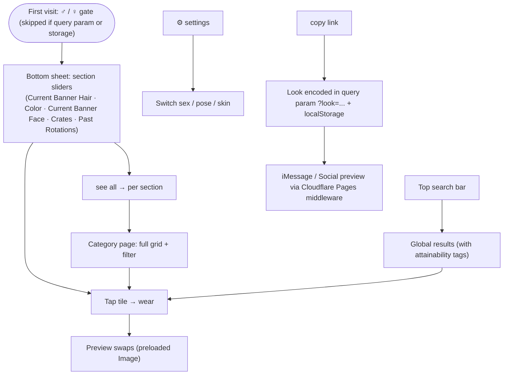
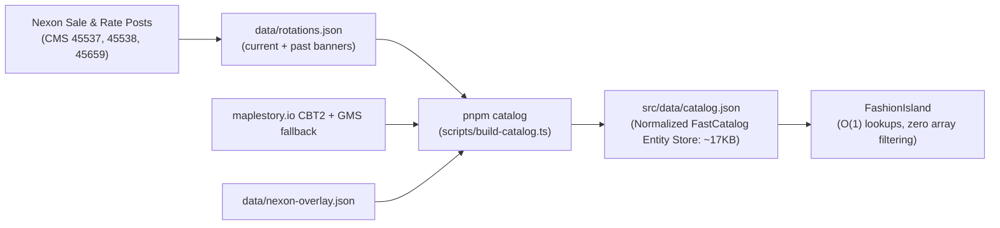
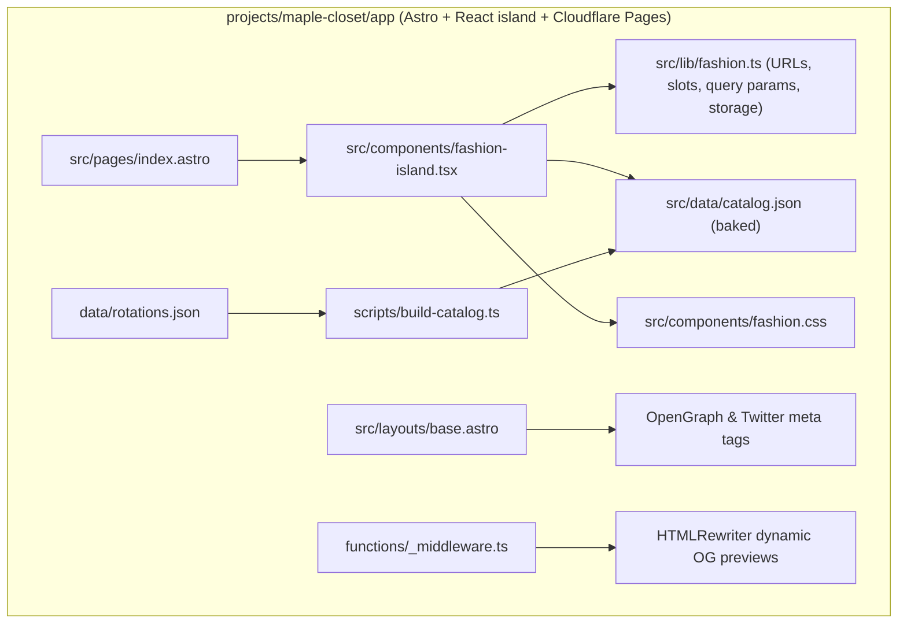

# Maple Fashion — Classic dress-up preview

Static web app for trying on MapleStory Classic World looks (male + female),
live character rendering, and link sharing with rich iMessage preview.

Live: https://maple-closet.builtby.win

## Flow

- **State** (`Look` in `src/lib/fashion.ts`): sex, skin, hair, hairCol, face, anim,
  frame, items. Persisted to URL query parameters (`?look=...`) on every change (`history.replaceState`) +
  saved in `localStorage` (`mf-look`, `mf-sex`). Shared links restore via `decodeLook`.
- **Preview**: `renderURL(look)` → `GET /api/MCW/CBT2/Character/{skin}/{ids}/{anim}/{frame}`.
  PNG, swapped only after offscreen `Image.onload` (no flicker).
- **iMessage / Social Sharing**: Query param `?look=...` is intercepted by Cloudflare Pages
  middleware (`functions/_middleware.ts`) which uses native `HTMLRewriter` to inject
  dynamic `<meta property="og:image">` pointing to the maplestory.io character render.
- **Hair & Face Banner Rotation System**:
  - Hairs and faces in MapleStory Classic are limited-time banner rotations (not permanently available).
  - **Current Banner**: Hairs and faces from the active announcement are placed **UP FRONT** and marked attainable with their end dates.
  - **Past Rotations**: Past styles remain browseable and wearable in the customizer, but are clearly tagged as **Not Attainable**, displaying when they were last attainable (e.g. `Last available: Aug 15 – Sep 15, 2026`).
  - **Unannounced Styles**: Arbitrary unannounced dump styles are not shown as "classic" or "always available".
- **Banner Updates**: Managed via `data/rotations.json` and the repository skill `.agents/skills/update-banners/SKILL.md` (`pnpm update-banners`).

## Data pipeline

## App structure

